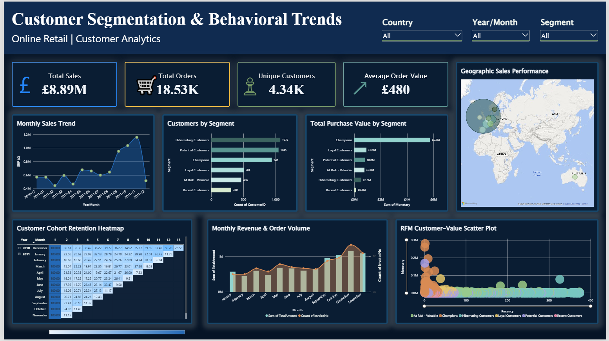
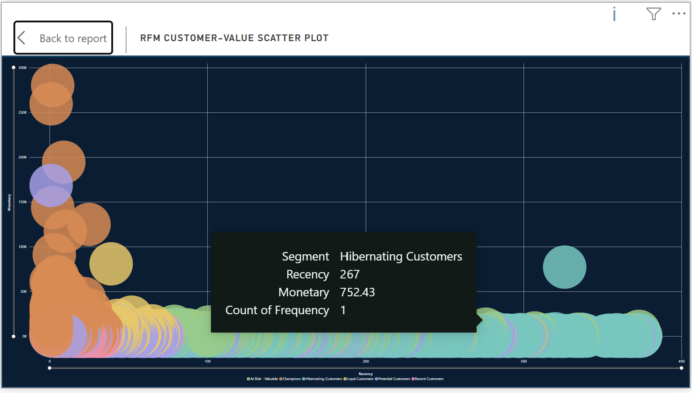
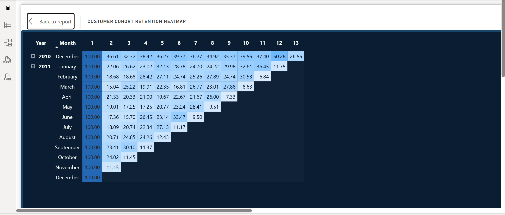

<div align="center">

# 🛍️ Customer Segmentation & Behavioral Trends Dashboard

**RFM analysis in Python → interactive Power BI dashboard for an online retailer**


<br/><br/>



</div>

---

## 📌 Project Overview

This project isolates distinct consumer behaviours in a year of online retail transactions. I clean the raw data, calculate **Recency, Frequency and Monetary (RFM)** metrics for every customer, group customers into behavioural segments, and export the results to **Power BI** to build an interactive dashboard with charts, cohort trends and a geographic map.

**Task objective:** design an interactive data portal to isolate distinct consumer behaviours.

| Requirement | How it was met |
|---|---|
| Compute Recency, Frequency and Monetary metrics | Customer-level RFM table with 1–5 quintile scores and six named segments |
| Export clean data to a BI suite | Cleaned transactions, RFM segments and cohort retention exported as CSV for Power BI |
| Interactive charts | KPI cards, segment charts, monthly trends and an RFM scatter plot |
| Cohort trends | Customer cohort retention heatmap |
| Geospatial filter tracking | Bubble map of sales by country, with Country, Year/Month and Segment slicers |

---

## 📊 Dataset

- **Source:** Online Retail transaction data (`Online_Retail.xlsx`), a UK-based online retailer
- **Period:** 1 December 2010 to 9 December 2011
- **Size:** 541,909 transaction rows with 8 columns: `InvoiceNo`, `StockCode`, `Description`, `Quantity`, `InvoiceDate`, `UnitPrice`, `CustomerID`, `Country`

The raw file lives in the [`source/`](source) folder. If it is missing, place `Online_Retail.xlsx` there before running the notebook.

---

## 🔄 Workflow

```
Raw data  →  Cleaning  →  RFM metrics  →  Scoring & segments  →  Cohorts  →  CSV export  →  Power BI
```

### 1. Data cleaning

Before any analysis I checked the data for problems and found:

- **5,268** duplicate rows
- **135,080** rows with no `CustomerID`
- **9,288** rows from cancellation invoices (invoice numbers starting with "C"), plus further negative-quantity rows
- **2,515** rows with a zero unit price and **2** with a negative unit price

I worked on a copy (`df_clean`) so the original data stays untouched, then:

1. Removed duplicate rows
2. Removed rows without a `CustomerID`
3. Excluded cancellation invoices
4. Kept only rows with a positive quantity and a positive unit price
5. Created `TotalAmount = Quantity × UnitPrice`

**Result:** 541,909 rows reduced to **392,692** clean rows covering **4,338 unique customers**.

### 2. RFM metrics

The reference date is the day after the last invoice (10 December 2011). For each customer:

| Metric | Definition |
|---|---|
| **Recency** | Days since the customer's last purchase |
| **Frequency** | Number of distinct invoices |
| **Monetary** | Total amount spent (£) |

Typical customer (median): last purchase **51 days** ago, **2** invoices, **£668.57** spent.

### 3. Scoring and segmentation

Each metric is scored from 1 to 5 using quintiles (for Recency, a lower value earns a higher score). The three scores are combined into an RFM score, and customers are assigned to a segment using these rules:

| Segment | Rule |
|---|---|
| 🏆 **Champions** | R ≥ 4, F ≥ 4 and M ≥ 4 |
| 💙 **Loyal Customers** | R ≥ 3 and F ≥ 4 |
| 🆕 **Recent Customers** | R ≥ 4 and F ≤ 2 |
| ⚠️ **At Risk - Valuable** | R ≤ 2, F ≥ 3 and M ≥ 3 |
| 😴 **Hibernating Customers** | R ≤ 2 and F ≤ 2 |
| 🌱 **Potential Customers** | Everyone else |

Rules are checked in the order shown, so each customer lands in exactly one segment.

### 4. Cohort analysis

Customers are grouped by the month of their first purchase. For each cohort, I calculate the percentage of customers who came back in each following month, which feeds the retention heatmap.

### 5. Power BI dashboard

The notebook exports three CSV files to the [`csv/`](csv) folder, which are loaded into Power BI:

- `customer_rfm_segments.csv`: one row per customer with RFM scores and segment
- `cleaned_retail_transactions.csv`: cleaned transaction lines
- `customer_cohort_retention.csv`: cohort retention percentages

---

## 🖥️ Dashboard Features

<div align="center">
<a href="images/dashboard.png">
  
</a>
<br/>
<sub>Click the image to open it full size</sub>
</div>

<br/>

| Visual | What it shows |
|---|---|
| **KPI cards** | Total sales, total orders, unique customers, average order value |
| **Monthly Sales Trend** | Revenue over time |
| **Customers by Segment** | How many customers sit in each segment |
| **Total Purchase Value by Segment** | How much each segment spends |
| **Geographic Sales Performance** | Bubble map of sales by country |
| **Customer Cohort Retention Heatmap** | Share of each cohort that returns month after month |
| **Monthly Revenue & Order Volume** | Revenue bars with order count line |
| **RFM Customer-Value Scatter Plot** | Recency against monetary value, coloured by segment |
| **Slicers** | Filter everything by Country, Year/Month and Segment |

---

## 📈 RFM & Cohort Analysis Charts

### RFM segmentation

Customers are scored on Recency, Frequency and Monetary value, then grouped into six segments. The first chart shows how many customers fall in each segment, and the second plots recency against monetary value for every customer, coloured by segment.

<div align="center">




</div>

- **Hibernating Customers** is the largest segment (1,072 customers), followed by Potential Customers (1,045) and Champions (941).
- Customers with low recency (bought recently) and high monetary value are the Champions; those with high recency (gone quiet) cluster at the right of the scatter plot.

### Cohort retention

Customers are grouped by the month of their first purchase, and the heatmap shows the percentage of each cohort that came back in the months that followed.

<div align="center">



</div>

- Read each row left to right: month 1 is always 100%, and later columns show the share of that cohort who purchased again.
- The December 2010 cohort retains best, at 36.6% in its second month; most 2011 cohorts return at around 15–24%.

---

## 🔍 Key Findings

**Headline numbers:** £8.89M total sales from 18,532 orders and 4,338 customers, an average order value of about £480.

- **A fifth of customers drive most of the revenue.** The 941 Champions are about 22% of customers but account for roughly £5.7M, around 64% of total sales.
- **The largest segment is Hibernating Customers.** 1,072 customers have not bought recently and have bought rarely, which makes them a clear target for win-back campaigns.
- **Valuable customers are slipping away.** 466 customers in the At Risk - Valuable segment have spent well before but have gone quiet, and they are the best candidates for retention offers.
- **Sales peak late in the year.** Monthly sales rose from about £951K in September to £1.16M in November 2011, the busiest month by sales, orders and active customers.
- **The business is concentrated in the UK.** The United Kingdom accounts for about £7.29M, roughly 82% of sales. The Netherlands, EIRE, Germany and France follow.
- **Retention is highest for the first cohort.** The December 2010 cohort returned at 36.6% in its second month, while 2011 cohorts mostly returned at around 15–24%.

> **Note:** December 2011 only covers the first 9 days of the month, so its totals are not comparable with full months. The last cell of each cohort row is also a partial month.

---

## 🚀 How to Run

1. **Clone the repository**
   ```bash
   git clone https://github.com/AreejSimab/customer-segmentation-dashboard.git
   cd customer-segmentation-dashboard
   ```
2. **Install the requirements**
   ```bash
   pip install -r requirements.txt
   ```
3. **Add the dataset:** place `Online_Retail.xlsx` in the `source/` folder.
4. **Run the notebook:** open `notebook/Customer_Segmentation.ipynb` in Jupyter and run all cells. The three CSV files are saved in the `csv/` folder.
5. **Build the dashboard:** open Power BI Desktop, load the three CSV files and recreate the visuals described above.

---

## 📁 Repository Structure

```
customer-segmentation-dashboard/
├── notebook/
│   └── Customer_Segmentation.ipynb   # Cleaning, RFM, segmentation, cohorts and CSV export
├── source/
│   ├── Online_Retail.xlsx            # Raw dataset
│   └── README.md                     # Describes the dataset
├── csv/
│   ├── customer_rfm_segments.csv
│   ├── cleaned_retail_transactions.csv
│   ├── customer_cohort_retention.csv
│   └── README.md                 # Describes each exported file
├── images/
│   └── dashboard-preview.png     # Screenshot of the Power BI dashboard
├── requirements.txt
├── .gitignore
├── LICENSE
└── README.md
```

---

## 🧰 Tools Used

Python • pandas • NumPy • Matplotlib • Seaborn • Jupyter Notebook • Power BI

---

## 🔮 Possible Next Steps

- Add a churn-risk model using the RFM scores as features
- Test K-Means clustering as an alternative to rule-based segments
- Add customer lifetime value to the dashboard
- Publish the report to Power BI Service for sharing

---

## 📄 License

The code and documentation in this project are released under the [MIT License](LICENSE). The dataset in `source/` remains subject to its original terms.

---

## 👩‍💻 Author

**Areej Simab**, BSc (Hons) Computer Science student focused on data science and analytics.

<a href="https://www.linkedin.com/in/areej-simab-3718502a3"></a>
<a href="mailto:areejsimab@gmail.com"></a>
<a href="https://github.com/AreejSimab"></a>

⭐ If you found this project useful, feel free to star the repository.
